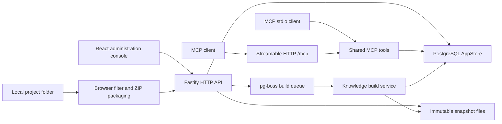

# Architecture

## Runtime

The React/Vite console and Fastify API are built into one Node.js 22.13.0 runtime. Production bootstrap validates environment, opens a PostgreSQL pool, applies ordered SQL migrations under an advisory lock, constructs the PostgreSQL store and pg-boss queue, recovers builds, and then starts HTTP. Memory persistence exists only in tests and the deterministic e2e entrypoint.

## Data flow

1. Each workspace contains multiple isolated projects. A project accepts a browser-filtered folder import, a clean server-local Git worktree, or a credential-free HTTPS mirror with the image's static askpass helper. The browser uses a temporary filtered ZIP only as the resumable transport format; the console has no direct ZIP selection workflow.
2. Folder imports discard dependencies, build output, binary files, and sensitive paths before resumable upload. The server repeats archive safety and source filtering, then records accepted UTF-8 text with byte-level hashes in an immutable project snapshot.
3. A durable build carries those persisted hashes into symbols/pages/citations, creates deterministic knowledge, and validates generated knowledge. Feedback rebuilds persist and inject their acknowledged feedback context.
4. Operators create and explicitly publish a release. Only the current published release is visible through MCP.
5. MCP tokens are project-scoped. Responses pin `releaseId` and `commitSha`; citations include path, inclusive line range, commit/content version, and blob hash.

## Ownership boundaries

- `src/server/app.ts`: HTTP routes, authentication, MCP HTTP transport, response contracts.
- `src/server/bootstrap.ts`: production dependency composition, migrations, queue startup, cleanup.
- `src/server/persistence/`: tenant-scoped memory/PostgreSQL persistence contracts.
- `src/server/git/`: secure mirror preparation and immutable snapshots.
- `src/server/knowledge/`: analysis, generation, search, release build lifecycle.
- `src/server/mcp/`: token authentication and the shared eight-tool surface.
- `src/server/security/`: password/session/encryption and HTTP security policy.
- `drizzle/`: ordered production SQL migrations.

## Shutdown and recovery

Signals call Fastify close once. Fastify stops accepting connections and closes active MCP servers; bootstrap then gracefully stops pg-boss before ending the PostgreSQL pool. On startup, queued builds with available snapshots are reenqueued, and a periodic reconciler retries persisted jobs after dispatch failures. Builds interrupted after claiming are marked failed rather than silently resumed. Cancellation is checked around knowledge persistence and the final ready transition is compare-and-set guarded against cancellation.

## Deployment state

PostgreSQL, snapshots, and repository mirrors are one consistency set. Compose persists them separately for operational clarity, but backup and restore must capture all three at the same application quiescence point.
