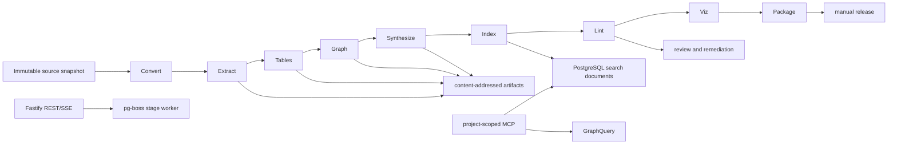

# 知识库内核、安全与 Vue 现代化设计

## 1. 决策与当前基线

本设计在现有模块化单体上演进，不拆分微服务。运行时固定为 Node.js 22、TypeScript、Fastify、PostgreSQL 16、pg-boss、React 19、Vite、Ant Design 5、TanStack Query 与 Playwright。生产启动由 `src/server/bootstrap.ts` 执行迁移、建立 `PostgresAppStore`、启动 pg-boss、恢复可重试构建并监听 HTTP；测试和确定性 E2E 使用 `MemoryAppStore`。

现有知识链路已经具备不可变 `source_snapshots`、`source_files`、符号/依赖索引、知识页、引用、构建、发布、MCP Token、项目成员权限、导入报告、变更影响、关键词检索和检索评测。上传在浏览器与服务端双重过滤依赖目录、构建产物、敏感文件和二进制内容。当前自动化基线为 320 个通过用例、5 个显式跳过用例；升级期间不得降低该基线。

Vue 管理端固定使用 `vue@3.5.13`。Vue 迁移不安装 `aheart-ui`、Ant Design Vue、Element Plus 或其他外部 UI 组件库；Vue 组件、可访问性行为、设计令牌和图标适配全部存于仓库。现有 React 管理端及其既有依赖在迁移期间不作范围外改动，直至生产切换门禁通过。每阶段由执行代理分别以产品经理视角和开发经理视角审查实际 diff；这是同一执行主体的决策自审，不表示存在外部审批人。

## 2. 目标、非目标与 clean-room

目标：

- 用可缓存、可取消、可局部失效的十阶段流水线产出可追溯知识、表、关系图、检索文档、质量问题和可视化包。
- 支持 TS、JS、TSX、JSX、Vue SFC、Markdown、JSON、YAML、CSV 和 XLSX；所有事实均可回到快照文件与行列范围。
- 提升中文检索、结构化查询和 Graph 查询质量，不引入 embedding、pgvector、Java、Python、公开注册或多租户计费。
- 将会话、CSRF、管理员 MFA、MCP Token、Git 出站、上传和表格资源边界收敛到可测试的安全合同。
- 在相同 REST DTO 下并行建设 Vue 管理端，并保留 React 回退入口。

非目标：运行用户上传代码、执行工作簿公式/宏、调用外部链接、自动发布、自动修复源码、跨项目聚合未授权数据、把候选关系伪装成事实、复制参考项目源码/配置/资源/Git 历史。

Clean-room 约束：参考系统只能提取产品概念、公开协议语义和测试目标。实现仅依据本仓库的新类型、新测试、新 SQL 与公开标准编写；提交不得包含参考项目文件、逐字页面文案、复制的测试夹具、第三方私有 URL 或 Git 对象。

## 3. 不变量

1. `workspace_id`、`project_id`、`snapshot_id`、`build_id`、`release_id` 必须在每个持久化读写和 MCP 查询边界出现；工作区 admin 可访问所有本工作区项目，其他成员仅访问显式项目成员关系。
2. 每个事实 `GraphNode`、`GraphEdge`、`TableSchema`、检索文档和知识块至少含一个有效 `SourceRef`；未证实关系只能以 `candidate` 存储与展示。
3. 所有构建产物由 `(snapshotId, pipelineVersion, stage, inputDigest)` 内容寻址；同键成功产物可复用，不同键不得覆盖。
4. 取消、失败、质量不达标、引用不完整和安全策略拒绝都不得改变当前 `release`；只有人工审核后的显式发布可以改变当前发布。
5. 单文件变更仅使其直接产物、依赖它的聚合产物、受影响图邻居与引用它的知识页失效；未受影响产物保持可复用。
6. 解析器不执行输入中的代码、公式、宏、外链、脚本、模板表达式或文件系统路径；输入路径在快照根目录内。
7. 任何 API、SSE、日志、审计和错误响应不返回密码、MFA 密钥、PAT、MCP Token 明文、原始会话 ID 或未授权项目名称。

## 4. 目标架构与数据流



新增 `src/server/knowledge/pipeline/`，仅依赖 `persistence/`、`security/`、`git/` 和显式适配器；路由层不直接调用解析器。一个构建由 `build_runs` 表和 pg-boss job 驱动，Stage worker 以事务领取 `build_stage_runs`，写入不可变产物后再推进下游 stage。SSE 从数据库状态投影，不以进程内事件作为唯一真相。

## 5. 公共合同

```ts
export const BUILD_STAGES = [
  "convert", "extract", "tables", "graph", "synthesize",
  "index", "lint", "viz", "validate", "package"
] as const;
export type BuildStage = (typeof BUILD_STAGES)[number];
export type StageStatus = "queued" | "running" | "succeeded" | "failed" | "cancelled" | "reused" | "skipped";
export type SourceKind = "code" | "document" | "config" | "table";

export interface SourceRef {
  snapshotId: string;
  path: string;
  startLine: number;
  endLine: number;
  startColumn?: number;
  endColumn?: number;
  blobHash: string;
}
export interface ArtifactManifest {
  id: string; workspaceId: string; projectId: string; snapshotId: string;
  buildId: string; stage: BuildStage; kind: string; schemaVersion: number;
  inputDigest: string; contentDigest: string; storageKey: string;
  sourceRefs: SourceRef[]; producer: "deterministic" | "llm";
  createdAt: string;
}
export interface StageRun {
  id: string; buildId: string; stage: BuildStage; attempt: number;
  status: StageStatus; inputDigest: string; outputManifestIds: string[];
  startedAt: string | null; finishedAt: string | null;
  errorCode: string | null; errorDetail: string | null;
}
export interface KnowledgeIR {
  schemaVersion: 1; snapshotId: string; files: IRFile[];
  symbols: IRSymbol[]; imports: IRImport[]; documents: IRDocument[];
  tables: TableSchema[]; sourceRefs: SourceRef[];
}
export interface IRFile {
  path: string; language: string; contentDigest: string; lineCount: number; sourceRef: SourceRef;
}
export interface IRSymbol {
  id: string; kind: "module" | "function" | "class" | "interface" | "type" | "component" | "command";
  name: string; qualifiedName: string; signature: string | null; sourceRef: SourceRef;
}
export interface IRImport {
  fromPath: string; specifier: string; kind: "static" | "dynamic"; sourceRef: SourceRef;
}
export interface IRDocument {
  id: string; title: string | null; text: string; sourceRef: SourceRef;
}
export interface TableColumn {
  name: string; type: "string" | "number" | "boolean" | "date" | "unknown";
  nullable: boolean; sensitive: boolean; formulaLike: boolean; sourceRefs: SourceRef[];
}
export interface GraphNode {
  id: string; projectId: string; snapshotId: string;
  kind: "module" | "symbol" | "document" | "table" | "column" | "command";
  name: string; qualifiedName: string; candidate: boolean;
  sourceRefs: SourceRef[]; attributes: Record<string, string | number | boolean>;
}
export interface GraphEdge {
  id: string; fromNodeId: string; toNodeId: string;
  kind: "imports" | "exports" | "calls" | "contains" | "documents" | "reads" | "writes" | "depends_on";
  candidate: boolean; confidence: number; sourceRefs: SourceRef[];
}
export interface TableSchema {
  id: string; name: string; sourcePath: string; sheet?: string;
  columns: TableColumn[]; rowCount: number; candidate: boolean; sourceRefs: SourceRef[];
}
export interface LintIssue {
  id: string; buildId: string; rule: string; severity: "error" | "warning" | "info";
  targetKind: "citation" | "knowledge" | "graph" | "table" | "search";
  targetId: string; message: string; sourceRefs: SourceRef[];
  remediationState: "open" | "accepted" | "rebuilding" | "resolved" | "dismissed";
}
export interface TrustScore {
  targetKind: "knowledge" | "graph_edge" | "table" | "search_result";
  targetId: string; score: number; citationScore: number; parserScore: number;
  freshnessScore: number; lintPenalty: number; reasons: string[];
}
```

`inputDigest` 是 canonical JSON 的 SHA-256：包含 `pipelineVersion`、stage、快照内容哈希、上游 manifest digest、解析器版本、配置版本与经过白名单化的 build purpose。`contentDigest` 是规范化 UTF-8 JSON 或二进制产物的 SHA-256。任何持久化 JSON 采用稳定 key 排序、ISO 时间和 UTF-8。

## 6. 阶段合同

| Stage | 输入与输出 | 缓存/失效 | 重试、取消、错误 |
| --- | --- | --- | --- |
| `convert` | `source_files` -> 规范化文本、行映射、文件类型 | `blobHash + converterVersion`；文件变更仅失效自身 | 读取瞬态错误重试 2 次；每 64 KiB 检查取消；`CONVERT_UNSUPPORTED` 跳过文件 |
| `extract` | convert manifest -> `KnowledgeIR` 文件、符号、导入、文档段落 | `convertDigest + parserVersion`；语法错误仅标记该文件 | 解析不重试；`PARSE_INVALID` 记录 lint，不中断其他文件 |
| `tables` | CSV/XLSX convert -> `TableSchema`、行采样 | `convertDigest + tablePolicyVersion` | 资源超限不重试；`TABLE_LIMIT_EXCEEDED` 作为安全错误 |
| `graph` | `KnowledgeIR`、tables -> nodes、edges、候选关系 | 所有受影响 IR/table digest；邻接聚合失效 | 事务冲突重试 2 次；写前检查取消；悬空事实边为 `GRAPH_DANGLING_EDGE` |
| `synthesize` | IR、graph、目的 -> 知识页/块/引用 | 受引用内容、模板、LLM policy；只重建受影响页 | deterministic 优先；LLM 失败降级；`CITATION_INVALID` 失败 stage |
| `index` | 已验证知识、表、图 -> `search_documents` | page/graph/table content digest | SQL 瞬态错误重试 2 次；幂等 upsert |
| `lint` | pages、citations、graph、tables、index -> `LintIssue`、`TrustScore` | 被检查 manifest digest | 无重试；error 使 package 不可执行 |
| `viz` | graph、tables、issues -> Mermaid、Markmap、JSON tree | graph/lint digest | 导出错误仅影响对应 viz artifact，不改变知识 |
| `validate` | 全部 manifest -> build validation report | 所有上游 digest | 无重试；错误或质量阈值不足时 build `failed` |
| `package` | 已验证 artifacts -> release candidate bundle | validate digest | 事务冲突重试 2 次；仅创建 draft，不发布 |

每个 stage 的 worker 按 `(build_id, stage)` 使用 `SELECT id FROM build_stage_runs WHERE status = 'queued' ORDER BY id FOR UPDATE SKIP LOCKED` 领取。失败时写 `errorCode` 和受限长度的安全详情；API 返回统一错误码。取消由 `build_runs.cancel_requested_at` 驱动：stage 在领取前、每个文件批次、每次写入前、提交前检查；已完成 manifest 留存但下游不调度。

## 7. 持久化模型

迁移按数字顺序增加以下表，均含 workspace/project/snapshot/build 外键或可从 build 反查，所有外键 `ON DELETE CASCADE` 仅作用于未发布草稿；已发布 release 引用的产物采用受限删除与显式归档。

```sql
CREATE TABLE build_stage_runs (
  id uuid PRIMARY KEY, workspace_id uuid NOT NULL, project_id uuid NOT NULL,
  build_id uuid NOT NULL REFERENCES builds(id) ON DELETE CASCADE,
  stage text NOT NULL CHECK (stage IN ('convert','extract','tables','graph','synthesize','index','lint','viz','validate','package')),
  attempt integer NOT NULL CHECK (attempt > 0), status text NOT NULL,
  input_digest char(64) NOT NULL, output_manifest_ids uuid[] NOT NULL DEFAULT '{}',
  started_at timestamptz, finished_at timestamptz, error_code text, error_detail text,
  UNIQUE(build_id, stage, attempt)
);
CREATE TABLE knowledge_artifacts (
  id uuid PRIMARY KEY, workspace_id uuid NOT NULL, project_id uuid NOT NULL,
  snapshot_id uuid NOT NULL REFERENCES source_snapshots(id), build_id uuid NOT NULL REFERENCES builds(id),
  stage text NOT NULL, kind text NOT NULL, schema_version integer NOT NULL,
  input_digest char(64) NOT NULL, content_digest char(64) NOT NULL, storage_key text NOT NULL,
  source_refs jsonb NOT NULL, producer text NOT NULL, created_at timestamptz NOT NULL DEFAULT now(),
  UNIQUE(project_id, snapshot_id, stage, kind, input_digest)
);
CREATE INDEX knowledge_artifacts_build_stage_idx ON knowledge_artifacts(build_id, stage);
```

`knowledge_graph_nodes` 使用 `(artifact_id, id)` 主键，`knowledge_graph_edges` 用 `(artifact_id, id)` 主键并以复合外键约束两端同一 artifact；事实边 `candidate=false` 以 trigger 检查两端存在且 `source_refs <> '[]'`。`table_schemas`、`table_columns`、`search_documents`、`knowledge_lint_issues`、`trust_scores`、`remediation_cases` 与 `remediation_events` 均引用 `artifact_id`。`remediation_cases` 状态只允许 `open -> accepted -> rebuilding -> resolved` 或 `open -> dismissed`；`dismissed` 必须写审计原因与操作者。

安全会话数据增加 `auth_sessions(id_hash, user_id, workspace_id, session_version, csrf_secret_hash, expires_at, revoked_at)`；当前轮次只保存随机 opaque session ID 和 CSRF nonce 的 SHA-256 哈希，绝不保存明文。后续 MFA 轮次再加 `mfa_verified_at`、`last_seen_at`、`ip_hash`、`user_agent_hash`。MFA 恢复码仅保存 scrypt 哈希；MCP Token 增加 `expires_at`、`last_rotated_at`、`scopes jsonb`，Token 明文只在创建响应出现一次。

## 8. 解析与资源策略

| 输入 | 确定性策略 | 上限与拒绝 |
| --- | --- | --- |
| TS/JS/TSX/JSX | TypeScript compiler API，`ScriptKind` 按扩展名；仅 AST、import/export、声明、JSDoc、literal command | 单文件 1 MiB；不得执行 module resolution、decorator、JSX runtime 或动态 import |
| Vue SFC | `@vue/compiler-sfc@3.5.13` 的 `parse`；`script`/`script setup` 交给 TS parser，template 仅抽取静态标签、属性和 `defineProps` 关联 | 单文件 1 MiB；拒绝自定义 block 的可执行 transform、远程 `src`、模板表达式执行 |
| Markdown | CommonMark AST；抽取标题、段落、代码块语言和相对链接 | 禁止 HTML 执行、远程 fetch；链接仅作为文本关系 |
| JSON/YAML | JSON.parse 与 `yaml` 的 `FAILSAFE_SCHEMA`；抽取对象路径和标量 | 禁止 YAML tag、alias 扩展、merge 执行；深度 32、节点 100,000 |
| CSV | 流式 RFC4180 parser；首行为 schema，采样前 100 行 | 50 MiB、100,000 行、256 列、单元格 32 KiB、30 秒 |
| XLSX | 只读取 ZIP 内 workbook XML 与 shared strings；公式显示为原始文本；禁用宏、externalLinks、OLE 和 vbaProject | 50 MiB 压缩、200 MiB 展开、100,000 行/256 列、512 MiB 内存、30 秒 |

表格 `TableSchema` 不保存全部单元格，只保存字段名、推断类型、空值率、去重数、前 20 行经过脱敏的样本和 `SourceRef`。以 `=`, `+`, `-`, `@` 开头的单元格被记录为 `formulaLike=true` 的纯文本，绝不执行。表头与样本中的邮箱、电话、Token 模式先脱敏再落库。

## 9. 确定性与可选 LLM

确定性阶段负责文件分类、AST、表结构、符号、依赖、Graph 事实边、引用、索引字段、lint 和发布门禁。LLM 只可在 `synthesize` 对已提取结构生成摘要、模块说明和检索同义词建议；输入为已过滤的 `KnowledgeIR` 片段和允许的 `SourceRef`，输出必须通过 Zod schema、引用存在性校验、行范围校验、blobHash 校验、重复引用去重和最大长度校验。

LLM 请求缓存键为 `modelProvider:model:promptVersion:inputDigest`，响应以加密配置中已有 provider key 调用且不写入原始 prompt。模型不可用、超时、结构无效或引用无效时，生成器使用 deterministic 模板，写 `ENHANCER_FALLBACK` warning；不能因 LLM 失败阻塞可验证的 deterministic build。LLM 绝不能创建无来源事实边、修改表 schema 或自动发布。

## 10. Graph 与导出/MCP

Graph 是一级产物，不从 markdown 反向推断。`contains`、`imports`、`exports`、`reads`、`writes`、`depends_on` 由 AST/配置确定，为事实边；文本相似、名称推测、文档关联为 `candidate=true`，需要引用并显示置信度。事实边不得指向不存在 node；candidate 边可引用未解析目标名称但 `to_node_id` 必须指向占位 candidate node。

脑图使用从项目 root 到 module/document/table 的 `contains` 生成生成树；额外边存入 `crossLinks`，循环以 `cycle=true` 标记，不复制节点。`viz` 产出 `graph.mmd`、`mindmap.mm` 和 `graph.json`，Mermaid 节点文本转义，Markmap 不嵌入 HTML。

新增 MCP 工具：

```ts
dkh_graph_query({ projectId, releaseId, nodeId?, query?, depth?: 1 | 2 })
dkh_table_schema({ projectId, releaseId, tableId })
dkh_quality_report({ projectId, releaseId })
```

三个工具只接受 Token 所属项目和已发布 release，返回 `releaseId`、`snapshotId`、`sourceRefs` 与 `TrustScore`；最大 depth 为 2、节点数为 100、响应体为 256 KiB。

## 11. 搜索与质量算法

查询在 NFKC、大小写折叠与中文标点归一化后，生成中文 bigram/trigram、ASCII token、路径 token、camelCase/snake_case 切词。意图分类为 `symbol`、`path`、`command`、`table`、`architecture` 或 `general`，仅按规则词典和语法决定，不调用模型。

候选来自 PostgreSQL `tsvector`、标题、正文、符号名、路径、命令名、表名与字段别名。分数为：

```text
score = 0.38*fts + 0.20*intentField + 0.14*exactSymbol + 0.10*path +
        0.08*commandOrTable + 0.06*graphNeighbor + 0.04*trust
```

`intentField` 在 `symbol` 查询提升符号/qualifiedName，在 `table` 查询提升表/列/别名，在 `command` 查询提升 package script。表别名由确定性归一化的表名、字段名、中文显示名和 YAML/JSON 路径生成。`graphNeighbor` 仅从同 release、事实边的一跳邻居计算，候选边不参与。`trust` 小于 0.60 的结果不进入前 5；没有合格结果必须返回空数组和创建反馈入口，禁止用低相关页面填充。

评测集以 JSONL 存于 `evaluation/knowledge-v2/`，至少 100 条，中英文各不少于 40 条，覆盖符号、模块、路径、命令、表、跨项目拒绝、无结果和中文自然问句。CI 计算 Recall@5、MRR、引用有效率和无结果误命中率。

## 12. Lint、可信度与 remediation

规则至少包括 `citation.missing`、`citation.out_of_range`、`citation.blob_mismatch`、`graph.dangling_fact_edge`、`graph.candidate_without_reason`、`table.limit`、`table.sensitive_sample`、`search.unpublished_document`、`knowledge.empty_required_page`、`knowledge.low_coverage`、`release.stale_snapshot`。`error` 阻断 `package`，`warning` 降低 TrustScore，`info` 只展示。

`TrustScore = 0.45*citation + 0.25*parser + 0.20*freshness - 0.10*lintPenalty`，结果 clamp 到 `[0,1]`。citation 为有效引用比例；parser 为确定性解析覆盖率；freshness 为 artifact 与 snapshot 一致性；lintPenalty 由未处理 warning/error 归一化。`validate` 要求：引用有效率 100%、错误数 0、平均 TrustScore >= 0.75、必需页覆盖率 100%。

remediation 由成员创建或从 lint 转化；接受后只计算受影响 sourceRef 的反向依赖闭包并创建 `purpose=remediation` build。该 build 不替换主 build、不自动发布，审核后才可创建 release draft。

## 13. 安全设计

- 会话：opaque、HttpOnly、Secure、SameSite=Lax cookie；数据库存 SHA-256 session ID，并将 session 绑定用户、工作区和 `sessionVersion`；登录、密码重置、禁用、角色变更和 MFA 变更递增 `sessionVersion` 并撤销旧 session。部署迁移可通过一次性的 UTC 截止时间启用旧 JWT 只读窗口，最长 24 小时，旧 JWT 绝不允许写入。
- CSRF：所有 cookie 鉴权的非 GET/HEAD/OPTIONS 请求要求浏览器回传 `devkh_csrf` cookie 同值的 `X-Devkh-Csrf`，该值含 session 绑定 HMAC 且数据库只留 nonce 哈希；MCP Bearer 请求不接受 cookie 且不走 CSRF。
- MFA：仅 workspace admin 可启用 TOTP；使用 20-byte Base32 secret、SHA-1 RFC 6238 30 秒步长和一个前后步长容差，secret 通过 AES-256-GCM 加密存储，恢复码只保存 scrypt 哈希。连续 5 次失败锁定 15 分钟；启用或停用 MFA 递增 `sessionVersion`，强制重新登录。普通停用 API 同时要求当前 password 与 TOTP，不接受恢复码。
- MCP Token：project-scoped、scope 最小化、固定 90 天过期、撤销和轮换；hash 存储，比较使用 constant-time；每次调用检查项目未归档、Token 未撤销/过期。
- SSRF/Git：仅 HTTPS，DNS 解析后拒绝 loopback、link-local、private、CGNAT、multicast、reserved IPv4/IPv6；禁止重定向、非 443 端口、URL 凭据和本地协议；clone 进程无 shell，`GIT_TERMINAL_PROMPT=0`，静态 askpass。
- 上传/表格：沿用双重文件过滤与 ZIP 防炸弹；表格限制见第 8 节；临时文件位于受限目录并在 finally 删除。
- 审计/备份/供应链：安全相关操作全部写 `audit_events`；备份含数据库、snapshot、artifact store 和 manifest，采用已有加密异机流程并每月恢复演练；`npm ci --ignore-scripts` 用于审计环境，lockfile 不允许漂移，CI 运行 `npm audit --omit=dev --audit-level=high`、许可证检查与 secrets scan。

## 14. Vue 并行迁移

Vue entry 为 `/console-vue/*`，React 回退为 `/console-react/*`，根 `/` 由 `CONSOLE_IMPLEMENTATION=react|vue` 反向代理到其中之一；Cookie、REST、SSE、项目选择 header、DTO、错误码、CSP nonce 和 MCP 页面完全共享。Vue 使用 `@vitejs/plugin-vue@6.0.8`、`vue@3.5.13`、Vue Router 4.5.0、`@tanstack/vue-query@5.66.0`，版本写入 lockfile。`6.0.8` 与当前 Vite 8 基线兼容，不能使用仅支持 Vite 5/6 的旧插件版本。

路由映射：`/projects`、`/projects/:projectId/overview`、`imports`、`versions`、`knowledge`、`collaboration`、`codex`、`/knowledge`、`/feedback`、`/members`、`/settings` 一一对应。共享 DTO 放入 `src/shared/api-contracts.ts`，Fastify schema、React client、Vue client 都由该文件的 Zod schema 推导。Vue 的 `ui/` 提供 Button、Input、Dialog、Table、Tabs、Toast、EmptyState、DataList，键盘、aria、焦点圈和移动布局由 Playwright 覆盖。

切换条件：Vue 所有路由功能对等、三种项目角色覆盖、桌面 1440px 与移动 390px 通过、SSE 重连和 CSP nonce 通过、错误率不高于 React 基线。切换后 React bundle 与 `/console-react/*` 保留两个发布周期；任一 P1 回归通过环境变量在一次 Nginx reload 内切回 React，不执行数据库回滚。

## 15. REST/SSE、迁移与灰度

新增 API：

```text
GET  /api/projects/:projectId/builds/:buildId/stages
GET  /api/projects/:projectId/builds/:buildId/events
GET  /api/projects/:projectId/graph?releaseId=&nodeId=&depth=
GET  /api/projects/:projectId/tables?releaseId=
GET  /api/projects/:projectId/quality?releaseId=
POST /api/projects/:projectId/remediations
POST /api/projects/:projectId/remediations/:id/accept
```

SSE event 为 `stage.updated`、`artifact.created`、`lint.updated`、`build.completed`，包含 monotonic `eventId`，客户端用 `Last-Event-ID` 恢复。旧 build 状态继续映射为 `queued|running|ready|failed|published`，新增 stage 状态仅在新 endpoint 公开；旧客户端不会收到未知状态。

迁移顺序：安全会话/MFA/Token 字段 -> pipeline 表 -> artifact/graph/table/search/lint 表 -> backfill 现有 released build 的 deterministic artifact -> 只读 Graph API -> 新 pipeline shadow build -> Vue entry。每个迁移先加表/列/索引，不删旧列；数据 backfill 分批 500；确认两次生产备份和 shadow 对比后才删除废弃索引。

可观测性：JSON 日志含 requestId、workspaceId hash、projectId、buildId、stage、errorCode、durationMs，不含查询全文或 secret。Prometheus 指标含 `knowledge_stage_duration_seconds`、`knowledge_stage_failures_total`、`knowledge_artifact_cache_hits_total`、`knowledge_search_quality_ratio`、`auth_csrf_failures_total`、`git_egress_denied_total`。灰度先在一个管理员项目 shadow build，随后 10% 项目启用新 pipeline，只读比较 24 小时，再扩大到 50%，最后人工确认后 100%。

## 16. 最终验收

- `npm run typecheck`、`npm test`、`npm run test:integration`、`npm run test:e2e`、`npm run secrets:scan`、`npm run licenses:check` 全部通过；测试总数不低于当前 320 通过。
- 评测集不少于 100 条，Recall@5 >= 0.90、MRR >= 0.75、引用有效率 100%、无结果误命中率 <= 5%。
- 单文件修改只重建依赖闭包；失败、取消、低质量 build 不改变当前发布；同 snapshot 的新旧内核结果存在可审计比较报告。
- 事实 Graph 无悬空 edge，所有事实/候选都含来源或候选理由；候选不参与事实检索重排。
- 表格不执行公式、宏、外部链接或嵌入代码，超出行列/大小/内存/时间限制可预测失败并清理临时文件。
- 跨项目、CSRF、会话撤销、MFA、Token 过期、SSRF、限流和敏感日志测试通过。
- Vue 覆盖现有 React 路由、三种项目角色和桌面/移动；React 回退入口经生产 smoke test 验证。
- 上线前完成数据库、snapshot、artifact store 的恢复演练，并通过一次生产域名的登录、导入、构建、Graph、检索、发布和回退冒烟测试。
