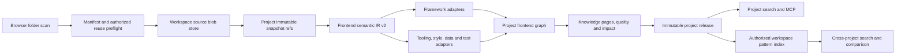

# 前端专业知识平台设计

> 状态：待用户审批。本文仅定义产品与技术方向，不代表已实施或已部署。

## 1. 产品目标

Dev Knowledge Hub 继续是知识库，但将从“可搜索的源码文档”升级为“面向前端工程师的可追溯工程知识系统”。最终它应当能回答下列问题，并为每个结论返回已发布版本、文件路径和精确行号：

- 这个页面的路由入口、布局、子组件、状态和 API 调用链是什么？
- 某个 React Hook、Vue composable、store 或请求方法被哪些页面使用？
- 实现“ECharts 下钻、联动、大数据缩放”时，以往授权项目有哪些可复用模式？
- 修改这个组件的 props、路由或 API schema 会影响哪些页面和测试？
- 项目使用了哪些设计令牌、组件库封装、权限守卫、请求约定和错误处理模式？
- 当前改动需要跑哪些单测、组件测试和 E2E，有哪些性能、可访问性和安全风险？

“学习过往项目”的含义是在用户有权限的已发布知识中检索、比较和提炼模式，不是用客户源码训练模型，也不是把多个项目的 Graph 合并成一个不可追溯的全局图。

## 2. 产品边界

### 保留

- 单 workspace、2–10 人、私有邀请制、多项目。
- 项目级源码、快照、构建、Graph、发布、MCP Token 和权限隔离。
- 人工构建和人工发布；同步不自动调用模型、不自动发布。
- 已发布知识不可变，所有答案绑定 release 与可验证引用。
- React 是唯一管理端，不新增通用 UI 库。

### 不做

- 不变成 IDE、在线代码编辑器或可视化搭建器。
- 不执行客户项目的 install、build、test 或 package scripts。
- 不渲染未经清洗的 HTML/SVG，不运行客户 JavaScript。
- 不使用未授权项目完成上传秒传探测、模式推荐或统计。
- 本轮不引入 embedding、pgvector、个人行为画像或自动修改代码。

## 3. 成功标准

### 知识深度

- 从路径和符号升级到包、应用入口、路由、页面、布局、组件、props/events/slots、Hook/composable、store、API operation、样式令牌、可视化、测试和构建配置。
- 从文件级 import 升级到路由到页面、页面到组件、组件到状态/API/样式、测试到目标的事实关系。
- React/Vite、Next.js App Router、Vue 3/Vite、Nuxt 必须先达到生产级深度；Angular、SvelteKit、Astro 通过同一适配器合同后续接入。

### 准确性

- 引用有效率 100%，未发布或未授权项目零泄漏。
- 前端专项评测 Recall@5 不低于 0.92，MRR 不低于 0.80。
- 核心实体抽取 F1 不低于 0.92，事实关系精确率不低于 0.95。
- 变更影响 Top-10 精确率不低于 0.85，相关测试 Recall 不低于 0.90。

### 工程性能

- 50,000 个有效文件上限不变；被忽略依赖目录不读取内容、不计数、不进入算法。
- 相同 workspace 内相同内容只保存一份物理 blob，但每个项目保留独立 path、snapshot、Graph、release 和权限。
- 单文件改动只重算对应语法 artifact 和项目依赖闭包；无变更同步不创建无效构建。
- 已发布项目搜索 P95 不高于 1 秒，前端图谱首屏可交互时间不高于 2.5 秒。

## 4. 目标架构



### 分层原则

1. **物理存储去重**：按 `workspace_id + sha256` 保存源文件 blob。
2. **语法事实复用**：对同内容和同解析器版本复用不含 project/path/source-ref 的文件级语法 artifact，在项目链接阶段重新绑定路径和引用。不放宽现有 `knowledge_artifacts` 的项目隔离。
3. **项目语义隔离**：路径、package/tsconfig 上下文、模块解析、路由、状态、API 和 Graph 在项目构建内重算，不跨项目复用。
4. **发布知识聚合**：workspace 搜索只聚合当前用户可访问项目的已发布知识。
5. **证据优先**：解析器产生事实与引用；LLM 只可在手动构建中补充摘要，不可创造事实边。

## 5. Frontend IR v2

IR v2 作为新的事实合同，通过 `schemaVersion: 2` 与现有 v1 并存。专业支持范围以 `docs/product/frontend-capability-matrix.md` 为唯一完成定义。

### 可实现合同

```ts
type AnalysisCompleteness = "complete" | "partial";
type EvidenceClass = "fact" | "candidate";
type KnowledgeValue<T> =
  | { state: "known"; value: T }
  | { state: "unknown"; reason: "dynamic" | "unresolved" | "limit" | "unsupported" | "unsupported_version" };

interface AnalyzerProvenance {
  analyzerId: string;
  analyzerVersion: string;
  parserConfigDigest: string;
  sourceBlobHashes: string[];
}

interface FrontendEntityBase<K extends FrontendEntityKind, A> {
  id: string;
  kind: K;
  name: string;
  qualifiedName: string;
  packageKey: string;
  canonicalPath: string;
  completeness: AnalysisCompleteness;
  attributes: A;
  facets: Partial<FrontendFacetMap>;
  sourceRefs: SourceRef[];
  provenance: AnalyzerProvenance[];
}

interface FrontendEdge {
  id: string;
  kind: FrontendEdgeKind;
  fromEntityId: string;
  toEntityId: string;
  evidenceClass: EvidenceClass;
  confidence: number;
  candidateReason?: string;
  sourceRefs: SourceRef[];
  provenance: AnalyzerProvenance[];
}
```

`FrontendEntity` 必须是按 `kind` 区分的 discriminated union，每种 kind 拥有固定的 typed `attributes`，不用任意 JSON 代替合同。`FrontendFacetMap` 由 analyzer registry 注册并使用各自 Zod schema 验证，不同 analyzer 不可写入同一 facet key。属性级无法确定的值使用 `KnowledgeValue<T>` 记录原因，不用 null 混淆“不存在”和“无法求值”。`fact` 边必须有可验证引用；`candidate` 边必须有 reason 和 0–1 confidence，且不得提高正式检索排名。静态无法完整求值的实体使用 `partial`，不得伪装 `complete`。

### 稳定 ID 与合并

- 命名实体 ID：`sha256("frontend-ir-v2\0" + kind + "\0" + packageKey + "\0" + canonicalPath + "\0" + semanticKey)`。
- 匿名实体 ID：包围命名实体 semantic key + 规范化 AST 遍历顺序；不使用 byte offset，避免无关空格导致 ID 全变。
- 边 ID：`sha256(kind + fromId + toId + canonicalEvidenceKey)`。
- core analyzer 拥有 name/qualifiedName/package/path 等 canonical fields；framework analyzer 只能向自己 analyzer namespace 下的 facet 增补。
- 同 ID canonical fields 冲突时生成阻断 lint，不使用“后写覆盖”。引用去重、provenance 排序和输出排序都必须确定。

### 实体与关系

新实体至少包含：

- `workspace_package`：npm/pnpm/yarn/bun workspace 包、入口和 package exports。
- `application_entry`：SPA、SSR、SSG、worker 和 server/client boundary。
- `route`、`layout`、`page`：路径、动态参数、嵌套关系、lazy loading、guard/middleware。
- `component`：React/Vue 组件、props、events、slots、children、exposed API。
- `hook_or_composable`：Hook/composable 定义、依赖和副作用摘要。
- `state_store`、`state_field`：Context、Redux/Zustand、Pinia、TanStack Query 等的读写关系。
- `api_operation`、`data_schema`：fetch/axios/OpenAPI/GraphQL/WebSocket/SSE 与请求响应类型。
- `style_token`、`style_scope`：CSS Modules、CSS-in-JS、Tailwind/UnoCSS、Sass/Less 变量和全局 token。
- `visualization`：ECharts/D3/Three.js/Canvas 实例、series、dataset、event、动态 option 和数据源。
- `test_case`、`test_fixture`：单测、组件测试、E2E 与被测目标。
- `tooling_config`：Vite/Webpack/Rspack/Rollup/Babel/SWC/tsconfig、lint、format、i18n 与环境配置。

事实关系至少包含 `contains`、`imports`、`exports`、`renders`、`routes_to`、`lazy_loads`、`provides`、`injects`、`reads_state`、`writes_state`、`requests`、`subscribes`、`styles`、`visualizes`、`tests`、`configures` 和 `depends_on`。只有解析器可验证的关系才是事实边；命名相似、文本共现等推断只能是候选边。

### 十阶段兼容

- `extract` 在 shadow 模式中同时产生 `knowledge-ir-v1` 和 `frontend-ir-v2`。
- `graph` 分别产生 Graph v1/v2；`synthesize/index/lint/viz/validate/package` 保留 artifact family，不混用 schema。
- stage input digest 包含 IR schema、Graph schema、artifact family 和 analyzer manifest digest。
- release 使用不可变 `release_artifact_family=knowledge-v1|frontend-v2` 判别读取合同。历史 legacy 与现有 `pipeline-package@1` release 保持 `knowledge-v1`，不得自动升级；只有 `frontend-v2` release 必须绑定当前 build 的成功/复用 package stage run、该 run 的 `output_manifest_ids` 中 `kind=frontend-pipeline-package` 且 `schema_version=2` 的 artifact、与 release 相同的 workspace/repository/project/snapshot、IR/Graph schema 和 analyzer digest。artifact 的 `build_job_id` 只表示首次生产者，不作为复用构建的归属证明。
- 环境变量和当前 analyzer 版本不得改变历史 release 读取。

## 6. 解析器与语言包合同

不为每个框架复制整条流水线，而是定义稳定的 `FrontendAnalyzer` 适配器：

```ts
interface FrontendAnalyzer {
  id: string;
  version: string;
  detect(context: ProjectManifest): DetectionResult;
  extractFiles(context: FileExtractionContext): Promise<FileFactArtifact[]>;
  linkProject(context: ProjectLinkContext): Promise<ProjectSemanticArtifact>;
  evaluate(fixtures: EvaluationFixture[]): EvaluationReport;
}
```

- **Core**：TypeScript/JavaScript、HTML、CSS/Sass/Less、JSON/YAML、package/workspace/tsconfig。
- **Tier 1**：React + Vite、Next.js App Router、Vue 3 + Vite、Nuxt。
- **Tier 2**：Angular、Svelte/SvelteKit、Astro。
- **Ecosystem analyzers**：React Router/Vue Router、Redux/Zustand/Pinia/TanStack Query、axios/fetch/GraphQL、ECharts/D3/Three.js、Vitest/Jest/Testing Library/Playwright/Cypress。
- **Toolchain analyzers**：Vite/Webpack/Rspack/Rollup/esbuild、Babel/SWC、pnpm/yarn/npm/bun workspaces、Nx/Turborepo。

依赖只用官方或成熟 parser，不用正则表达式伪装 AST。新 parser 必须通过依赖许可、资源限额、恶意输入和引用准确性评审后才进入主流水线。

### 版本支持合同

- `evaluation/frontend/versions.json` 是框架、工具链、parser 与 fixture 版本范围的唯一事实源；能力矩阵只展示人可读摘要。
- 每个 analyzer 任务开始前，先基于官方兼容说明和仓库锁定依赖提交精确 semver 范围、代表 fixture 版本、parser 版本和停止支持条件。该文件未经技术经理复审不得开始实现，也不得在实现过程中静默扩大版本范围。
- V1 的初始基线必须覆盖当前仓库锁定的 React/Vite/TypeScript 组合，并包含一个经批准的 React 18 兼容 fixture；Next、Vue、Nuxt 和 Tier 2 的精确范围分别在对应版本任务开始时冻结。
- 管理端和 MCP 只根据 release 持久化的 analyzer manifest 宣称版本支持。范围外语法必须返回 `partial/unknown(unsupported_version)`，不能按已支持结果展示。

## 7. 工作区去重与项目价值

### 存储模型

- `source_blobs(id, workspace_id, content_hash, generation, byte_size, storage_key, state, gc_fence_token, tombstoned_at, created_at)` 以 `id` 为主键，`(workspace_id, content_hash, generation)` 唯一；`state` 只允许 `active|tombstoned|trash|deleted`。同一 workspace/hash 在 `active|tombstoned` 中最多存在一代。
- `source_files` 继续表示“某项目快照的某路径”，通过不可变 `source_blob_id` 引用具体 generation；不能只按 hash 解析当前 blob。
- `source_analysis_artifacts(workspace_id, content_hash, analyzer_id, analyzer_version, parser_config_digest, ...)` 只保存与项目无关的相对位置和语法事实；项目路径、snapshot id、Graph 和 source ref 不得写入该缓存。
- 不保存可漂移的 `ref_count`；引用数从 `source_files` 计算，并由延迟 GC 二次确认。
- blob 与快照视图固定位于同一 `snapshot_data` 卷和同一备份归档：`blobs/<workspace>/<prefix>/<sha256>/<generation>` 与 `snapshots/<snapshot>/files/...`。文件夹上传和 Git 快照统一通过 blob store 组装 hardlink 只读视图。启动时检测不支持 hardlink 的部署并保持 `legacy`，不静默复制冒充去重。
- v2 convert artifact 只保存 blob 引用与规范化元数据，不再把源码 bytes 整份复制到 artifact store。shadow 期为保持 v1 正式读取仍会产生旧 artifact，只有 v2 active 的新构建停止该重复。

### 上传协议

1. 浏览器扫描时就跳过依赖和生成目录，并在 Web Worker 中计算可接受文件 SHA-256。
2. `POST .../upload-sessions` 创建绑定 workspace/project/user/sessionVersion 的 24 小时会话。
3. `PUT .../manifest-pages/:page` 以 JSON 每页最多 500 条上传 manifest；服务端只对用户已有权访问且物理内容验证通过的 active generation 返回 `reuse_authorized`，其余一律 `upload_required`。
4. `PUT .../files/:ordinal` 以 `application/octet-stream` 上传必需 bytes；服务端重算 hash、重做过滤和限额。图片/字体/媒体没有上传 bytes 时只能记为 `trust=client_unverified` 的 asset manifest，API 和界面固定显示“未由服务端验证”，不能形成内容事实、Graph 事实边或 citation。
5. `POST .../commit` 提交 manifest digest，`DELETE .../:sessionId` 取消。所有写请求使用 `Idempotency-Key`，每次重新鉴权；用户失权/禁用/sessionVersion 变化后整个会话失效。
6. 上传和 GC 对同一 workspace/hash 使用相同 advisory lock。两个并发上传通过临时文件、`fsync`、原子链接/重命名和 active-generation 唯一约束只留一份；若现有 generation 已进入 `trash/deleted`，服务端重新验证 bytes 后创建新 generation，不复活旧 generation。
7. 同项目同 manifest 直接返回 no-op；逻辑文件数和 2 GiB 限额包含被复用文件，去重不能绕过安全限额。
8. 用户可见报告返回 logical/uploaded/authorized-reused files/bytes 和 unchanged；服务器因未授权内容进行的内部去重不进入可见统计。

### 项目不会失去价值

项目是语义、权限和发布边界，不是物理文件夹。同一个 `Button.tsx` 可以在两个项目中共享物理 blob 和文件级语法 artifact，但因为它的路径、路由、调用者、样式上下文和发布版本不同，会得到两套项目语义和引用。

## 8. 跨项目经验复用

新增 workspace pattern layer，但它只引用项目已发布知识：

- `workspace_patterns`：只保存不对用户展示的 opaque group id、能力类别和生命周期元数据；不得把全 workspace 聚合标题、符号、特征、Trust、计数或推荐状态直接作为查询结果。
- `workspace_pattern_evidence`：每条证据独立保存项目、release、Graph node/edge、规范化特征和 citations；管理员批准记录必须保存其 evidence basis。
- 查询先按实时 ACL 过滤 evidence，再仅用可见 evidence 计算标题、特征、Trust、计数、排序和推荐门槛。批准 basis 不能全部可见时，该批准对当前用户无效；缓存必须绑定 ACL revision 与可见 release 集合。
- 自动生成的可见投影先为 candidate，只有当前可见 evidence 自身满足明确的多项目证据门槛，或存在 basis 全部可见的管理员批准，才进入默认推荐。
- 项目移除成员、撤销发布可见性或归档后，查询时立即按权限过滤，不依赖离线已聚合的 ACL。
- 结果始终显示“当前项目事实”与“过往项目参考”的区别，避免用户误以为参考实现就是当前项目约束。

Codex 通过两个独立 MCP Server 组合上下文：项目 MCP 返回当前项目的必遵守事实，workspace MCP 返回用户有权访问的过往项目实现参考。现有项目 MCP Token 始终只读本项目，不增加跨项目 scope。跨项目参考使用独立的、绑定 workspace 成员身份的短期 workspace MCP Token 和 `/mcp/workspace` endpoint；`dkh_find_prior_implementations` 必须接收 `currentProjectId`，实时验证调用者仍可访问该项目，并从 evidence、结果、计数、Trust、排序和缓存键中排除该项目。缺少该参数返回稳定的 MCP invalid-params 错误；普通团队搜索只属于 REST，不伪装成 prior implementations。成员禁用、会话版本变更或任一项目失权时结果立即变化。

## 9. 前端知识页与工作台

### 全局知识库

- 当前项目选择器：请求显式携带 `currentProjectId`，选项每次按当前 ACL 过滤。未选时进入“团队知识搜索”，不产生任何当前项目事实；显式提交无权项目直接返回 `403 PROJECT_ACCESS_DENIED`，不降级为普通空状态。
- 团队搜索：项目、框架、命中类型、版本、Trust 和引用。
- 前端模式库：路由、组件、状态、API、图表、表单、权限、测试和工程化模式。
- 实现对比：选择两个已授权项目，对比实现、依赖、约束和引用，不给出无证据的“最优”结论。
- 无结果反馈：绑定查询、可见项目集合与发布版本，不采集个人画像。

### 项目前端地图

- 概览：技术栈、应用入口、workspace packages、质量与最近变更。
- 路由与页面：嵌套路由树、layout、guard、lazy boundary 和页面依赖。
- 组件与设计系统：组件分类、props/events/slots、使用热点、tokens 和样式影响。
- 状态与数据：store/query/API 操作、读写链、缓存 key 和运输类型。
- 可视化：ECharts/D3/Three.js 实例、配置、数据源、事件和复用候选。
- 构建与测试：命令、配置、测试覆盖映射、变更建议。
- Graph 与影响：专业交互图、节点聚类、路径聚焦、事实/候选关系分层、源码侧栏和变更影响。

## 10. 安全、保密与恢复

- 物理去重只在同 workspace 内发生；客户私有化部署之间不共享 hash 索引或 blob。
- 生产 parser 运行在独立的无网络 Compose service 中，通过 Unix domain socket 接收验证后 bytes 和虚拟只读路径；容器不挂载生产凭据、数据库或项目卷，使用只读根文件系统、非 root、能力清空、`no-new-privileges` 和 CPU/内存/pids 限额。容器内可终止 worker 负责 wall-clock timeout、取消、输入/输出 byte 限额、AST 节点限额和 crash replacement；不执行 config/package scripts，客户源码不能导致模块执行或出站请求。
- 所有 SVG/HTML/CSS 只做 AST 解析，展示时必须转义，不注入 DOM。
- blob 与 snapshot view 位于同一 `snapshot_data` 卷和同一 `snapshots.tgz` 归档，以保留 hardlink 关系。该归档与 PostgreSQL、repository mirror、legacy uploaded sources 和 artifact 作为同一恢复一致性集备份；恢复必须检验 DB 引用、hash、inode 共享与物理占用。
- 第一版 blob GC 默认关闭；恢复演练、并发引用和七天宽限期验证通过后才启用。GC 使用 `active -> tombstoned -> trash -> deleted` 两阶段回收：在 workspace/hash advisory lock 与数据库事务内二次确认该 generation 零引用并写 `tombstoned_at`；随后把该 generation 原子重命名到同卷 `.trash/<workspace>/<hash>/<generation>`，对源/目标父目录执行 `fsync` 后标记 `trash`；再经过额外宽限期才删除物理文件并最终标记 `deleted`。
- GC reconciliation 必须覆盖所有崩溃点：`tombstoned` 且原文件仍在时重试移动；若原文件已移动则先验证 trash 文件并完成 `trash` 状态；`trash` 且垃圾文件仍在时继续等待或删除；`trash` 但文件已不存在时再次确认该 generation 零引用后完成删除。创建新 `source_files` 只能引用 `active` generation；上传遇到原文件仍有效的 `tombstoned` generation 时取消 tombstone 并复用，遇到已移动的 generation 时先完成 reconciliation 再创建新代。旧 generation 进入 `trash` 后永不复活，但服务端重新验证的相同 hash 可在同一锁内创建新 active generation；GC 的 fencing token 只允许移动/删除自己锁定的 generation。任何状态不一致都停止该 generation 并写审计，不猜测删除。
- 备份使用现有 restic 加密；本设计不宣称生产源文件卷已有应用层静态加密。

## 11. 发布策略

新能力独立于当前 Phase F 生产观察，不在该分支上实施。`DEVKH_FRONTEND_KNOWLEDGE_MODE=legacy|shadow|active` 只表示系统允许上限，项目实际状态持久化在 `project_frontend_rollouts`。

| Knowledge kernel | Frontend 系统上限 | 项目允许值 |
|---|---|---|
| `legacy` | 任意配置都被压为 `legacy` | `legacy` |
| `shadow` | `legacy`/`shadow` | 不高于系统上限 |
| `active` | `legacy`/`shadow`/`active` | 不高于系统上限 |

无项目 override 时默认 `legacy`。配置不可能组合拒绝启动或拒绝修改，不静默提权。

- `legacy`：当前解析、检索和上传行为不变。
- `shadow`：生成 IR v2、新 Graph、新排序和去重报告，但当前 release/正式搜索/MCP 仍读旧结果。只有 workspace admin 可通过已鉴权 preview/comparison API 查看 candidate package。
- `active`：只在数据迁移、恢复演练、代表项目黄金流程和量化指标全部通过后为指定项目开启。

V1 Trial 可在与生产 DB、持久卷和域名完全隔离的 staging 中，经 V1 Demo 三层复审后为代表项目开启 `active` 并人工发布不可变 v2 测试 release。跨项目 pattern、正式 project MCP 的 v2 输出和 workspace MCP 只能读这类已发布 v2 release，不得读 shadow candidate。

每个 frontend release 持久化 `release_artifact_family=frontend-v2`、当前 build 的 `package_stage_run_id`、该 run 的 `output_manifest_ids` 所引用的 `frontend-pipeline-package@2` artifact、IR schema、Graph schema 和 analyzer manifest digest，并由数据库不可变触发器保护；这组 v2 provenance 必须全有或全无。stage run 与 artifact 必须和 release 的 workspace/repository/project/snapshot 一致，`package_stage_run_id` 使用 `ON DELETE RESTRICT`。复用 artifact 的首次生产 build 可以不同；本次 release 的归属只由当前 build 的 terminal package stage run 证明。历史 `knowledge-v1` release 保持现有 `legacy` 或 `pipeline-package@1` 读取/回滚合同，不受当前环境变量、项目 override 或 analyzer 版本影响。

## 12. 产品状态与黄金流程

前端知识页必须显式覆盖：未选择当前项目、未导入、已导入未构建、构建失败、候选未发布、已发布但快照更新、Graph 为空、项目权限失效、workspace Token 过期/撤销、没有可访问历史项目、历史证据全部失权、网络失败和历史引用已撤权。每个状态说明发生了什么、数据是否安全、下一步和重试幂等性。

三条产品黄金流程为：

1. **新功能历史借鉴**：当前项目事实与授权历史项目参考分区返回，各自绑定 release/citations。
2. **页面到 API 排错**：从 route/page/component/state/query 追踪到 API operation 和 error handling。
3. **改动影响与测试**：修改 prop/store/API/style token/chart option 时返回受影响页面、组件和测试。

REST 团队搜索响应必须使用 `currentProjectFacts`、`priorProjectReferences` 和 `currentProjectStatus=not_selected|ready|no_release|stale` 三个独立字段，不允许只用 UI 标签区分后混在一个排名列表。显式请求无权限项目使用 `403 PROJECT_ACCESS_DENIED`，不返回 `forbidden` 业务状态。MCP 固定为双 Server：project MCP 只返回当前项目事实，workspace MCP 只返回授权历史参考；由 Codex 在黄金流程中组合，两者都不得伪造另一分区。

## 13. 关键产品决策

1. 前端深度优先于“所有语言都浅尝辄止”；React/Vue/Next/Nuxt 先通过专业门槛。
2. 项目是权限和语义边界，workspace 是受控的经验复用边界，blob 只是物理存储边界。
3. 跨项目推荐必须有项目、release 和 citations，并明确标注为参考。
4. 先用确定性 AST、Graph 和评测建立质量，当评测证明必要时再引入向量或更强 LLM。
5. 新增框架的完成定义是“实体、关系、知识页、检索、影响、引用和真实 fixture 均通过”，不是“扩展名能上传”。
